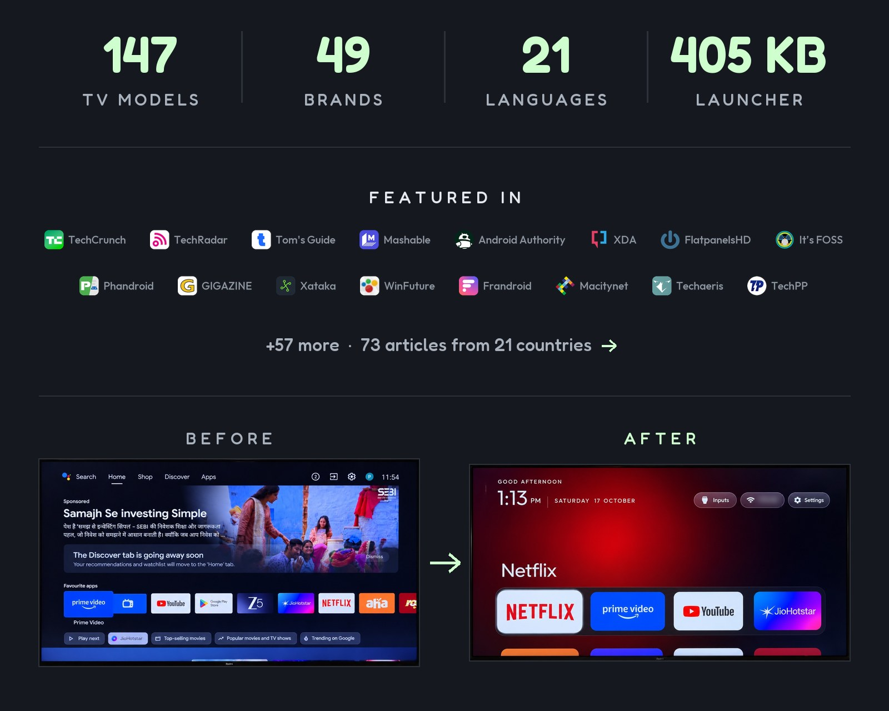
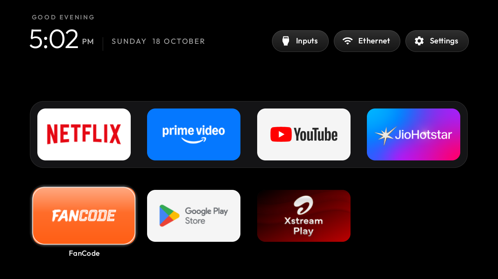
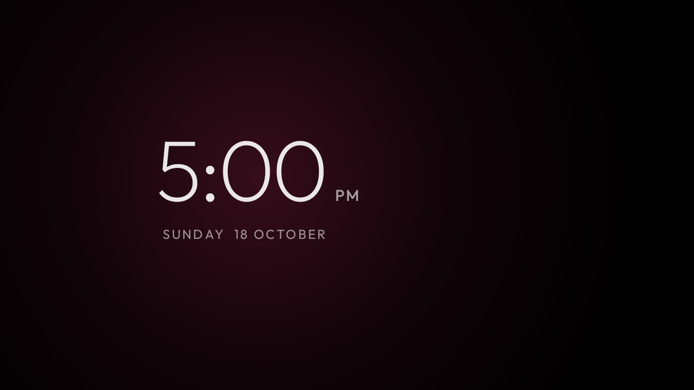
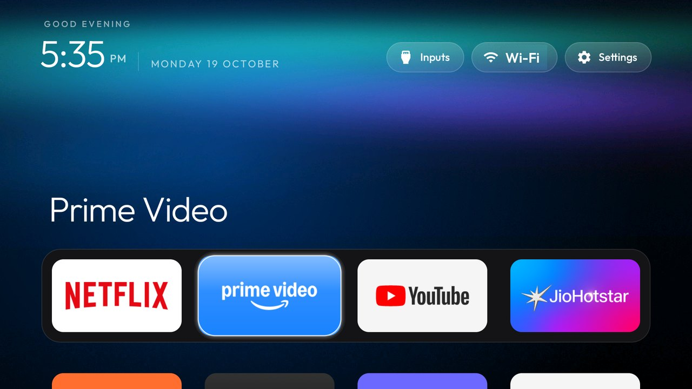
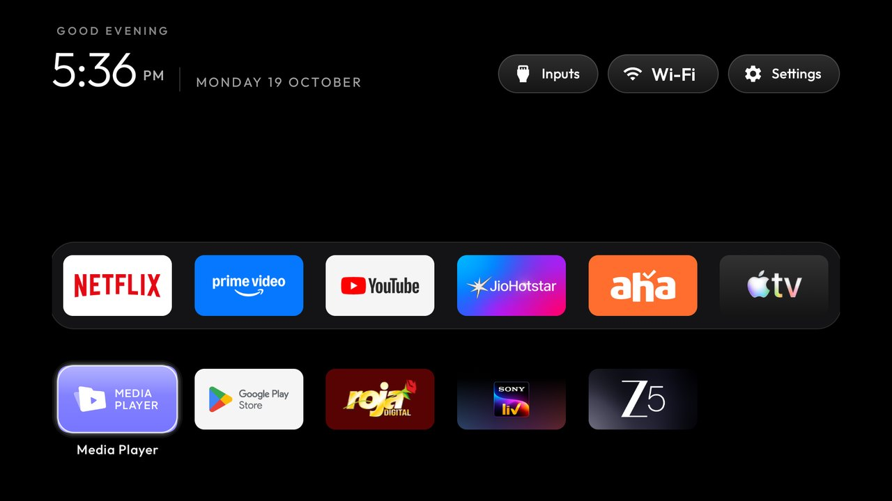

<p align="center">
  <a href="https://cleanyour.tv"></a>
</p>

<p align="center">
  <a href="https://github.com/Gathin23/cleanyourtv/stargazers"></a>
  <a href="https://github.com/Gathin23/cleanyourtv/pulls?q=is%3Amerged"></a>
  <a href="https://github.com/Gathin23/cleanyourtv/network/members"></a>
  <a href="https://github.com/Gathin23/cleanyourtv/graphs/contributors"></a>
  <a href="README.zh-CN.md"></a>
  <a href="https://buymeacoffee.com/gathint"></a>
  <a href="https://www.producthunt.com/products/cleanyourtv"></a>
</p>

<p align="center">
  <a href="docs/PRESS.md"></a>
</p>

> Vibe coded my parents' TV this afternoon! It was showing a sponsored ad before you could even get
> to Netflix. Gave Claude Code the model number, it found the TV on wifi, removed 25 Xiaomi packages
> and wrote a new launcher. Looks like an Apple TV now lol.
>
> [@gathint, 17 October 2026](https://x.com/gathint/status/2111379569030939102). The replies are where
> most of the TV lists here came from. The repo was called tv-vibehack until the 19th; old links work.

## How it works

Android TVs have the same debug bridge as Android phones. Switch on USB debugging in the TV's
developer options, allow your computer once, and the rest is standard Android tooling:

1. **Back up** the list of installed packages and settings.
2. **Disable** the manufacturer's telemetry, ad services, content rows and preloaded junk with
   `pm disable-user`. Nothing is uninstalled, so a restore script can undo every step.
3. **Install** a small native launcher and make it the default home screen.

**No root, no cable, nothing uninstalled, and a one-line restore if you change your mind.**

The bloat differs by brand, so the prompt has your coding assistant discover it on your TV and ask
before touching anything you might use.

## Quick start

You need a computer on the same Wi-Fi as the TV and a coding assistant with shell access.
Suggested: Claude Code on [0G Private Computer](https://pc.0g.ai), one API key for 100+ models.
[Claude Code](https://claude.com/product/claude-code) with an [Anthropic plan](https://claude.com/pricing),
[Codex](https://github.com/openai/codex) or [Gemini CLI](https://github.com/google-gemini/gemini-cli) work too.

| | |
|---|---|
| **1. On the TV** | Settings → Device Preferences → About → press OK on **Build** seven times → back → Developer options → **USB debugging** on. If you see a Network or ADB debugging toggle, turn that on too. Keep the TV on. |
| **2. On your computer** | Paste [`PROMPT.md`](PROMPT.md) into your assistant and fill in your TV model. |
| **3. Follow along** | Accept "Allow USB debugging?" on the TV, then answer the checklist: which apps you use, which four go in the dock, whether to keep the voice assistant, Chromecast and updates. |

The assistant backs up, debloats, builds and installs the launcher, and checks each step with
screenshots pulled from the TV. With this repo as context it takes about fifteen minutes.

## What you get

- **A pitch-black home** with a dock of your four favourite apps in a rounded band, where Apple TV puts it.
- **A top shelf** naming the focused app in large type, with an ambient glow in a colour taken from its artwork.
- **The rest of your apps in a grid** that slides up when you press Down.
- **One floating glass highlight** that springs from tile to tile. The focused tile lifts and shows its name.
- **Three frosted buttons**: Inputs (HDMI ports under the names you gave them in the TV's settings, AV, Live TV), Wi-Fi or Ethernet with the network name, Settings.
- **A greeting, a thin clock and the date** in [Outfit](https://fonts.google.com/specimen/Outfit), and a matching Clock screensaver. Set `show_stats` in config or a theme for one line under the clock: CPU, free memory and free storage. It stays off unless you turn it on, and it refreshes only while Home is on screen.
- **Themes** that change colours, wallpaper, dock and columns without a rebuild, and **module cards** that let other apps plug a tile in, only with your say-so.

And a TV that stops working against you: no sponsored rows, no "Discover" nags, no analytics
phoning home, no apps you never asked for.

| | |
|---|---|
|  |  |
| *Top shelf and ambient glow* | *Inputs: HDMI with connection state, AV, Live TV* |
|  |  |
| *The grid, one glass highlight, the tile's name* | *Clock screensaver, drifts so nothing burns in* |
|  |  |
| *Aurora theme, pushed with `tools/theme.sh`* | *Six columns and a six-app dock, same launcher* |

## Supported TVs

Anything running **Android TV** or **Google TV**. Samsung (Tizen) and LG (webOS) run different
systems; see [SHOWCASE.md](SHOWCASE.md) for a webOS port, and
[docs/devices/samsung-tizen.md](docs/devices/samsung-tizen.md) for what a 2021 Samsung set answers
over Wi-Fi (no ADB, so no `pm disable-user`) if you are weighing a Tizen port. **Fire TV** takes the
debloat half only, since Fire OS will not hand Home to a third-party launcher. A few China-market TCL
sets refuse to install any launcher at all; their lists say so in the header.

Tested lists from contributors, one folder per model in [`examples/`](examples/):

**TCL** 32 · **Sony** 18 · **Xiaomi** 17 · **Philips** 8 · **Hisense** 6 · **Amazon Fire TV** 5 ·
**Panasonic** 3 · **BenQ** 2 · **CHiQ** 2 · **Google** 2 · **Haier** 2 · **Hitachi** 2 · **Kalley** 2 ·
**NVIDIA Shield** 2 · **OnePlus** 2 · **onn** 2 · **Skyworth** 2 · **Thomson** 2 · **Toshiba** 2 · **Vu** 2 ·
AiPro2K · AIWA · Cecotec · Challenger · Compac · EKO · FFalcon · Freebox · Insignia Fire TV · JVC ·
Kogan · Motorola · MTC · Polytron · PRISM+ · RCA · Redmi · SANYO · SHARP · Tele System · Verizon ·
Vidda · Vision ·
BYINTEK, JMGO, Portronics, Stellamore, Wanbo and XGIMI projectors

<details>
<summary><strong>The full list</strong></summary>

| TV | OS |
|---|---|
| AiPro2K (Expressluck, dongnae; Changhong AI PONT family) | Android TV 14 |
| AIWA AI PONT SA (Changhong, osaka, ISDB86AW) | Google TV 14 |
| Amazon Fire TV 50" 4K smart TV (AFTTIFF43, brandenburg) | Fire OS 7.7.1.7 / Android 9 |
| Amazon Fire TV Stick 4K Max, 1st gen 2021 (AFTKA, kara), Colombia | Fire OS 7.7.1.3 / Android 9 |
| Amazon Fire TV Stick 4K, 1st gen 2018 (AFTMM, mantis) | Fire OS 6.7.1.1 / Android 7.1 |
| Amazon Fire TV Stick 4K, 2nd gen 2023 (AFTKM, karat), Brazil | Fire OS 8.1.8.5 / Android 11 |
| Amazon Fire TV Stick Lite, 1st gen 2020 (AFTSS, sheldon) | Fire OS 7.7.1.7 / Android 9 |
| BenQ E55-735 (Changhong AI PONT, DVB96BQ) | Google TV 14 |
| BenQ E55-750 (Changhong AI PONT, DVB96BQ) | Google TV (Android 11) |
| BYINTEK Love U4 projector, 1080P (Skyworth RG_HS352, HiSilicon Hi3751V350, 1 GB), Brazil | Android 9 |
| BYINTEK T5 Max projector (built-in Google TV stick: SkyworthDigital YYT, Amlogic), Brazil | Google TV 14 |
| Cecotec VQU10065S 65" QLED (Vestel-built, shandao, MediaTek), Spain | Android TV 14 |
| Challenger 32T22 BT (cvt_mt5863_col, board TP.MT5510.PB781, MediaTek MT5659, 1 GB RAM), Colombia | Android 7.0 |
| CHiQ AI PONT (Changhong GTVU65, dangni, MediaTek mt5867) | Google TV 14 |
| CHiQ AI PONT (DVB93CQ) | Android TV 11 |
| Chromecast with Google TV 4K (sabrina) | Google TV 14 |
| Compac ATV R2 (SCBC R2, Realtek RTD285O) | Android TV 9 |
| EKO 2K Google TV (MTC-built, tennoji, MediaTek mt5867 / T56) | Google TV 14 |
| FFalcon (雷鸟) 鹤6 PRO 65S585C Pro (China, tcl_mt5879_cn, MediaTek MT9653) | Android TV 11 |
| Freebox Player POP (Free, fbx8am, Amlogic), IPTV/DVB-T box | Android TV 10 |
| Google TV Streamer 4K (kirkwood, GZRNL) | Google TV 14 |
| Haier Android TV DVB2K (broadway, HaierATVT56DVB) | Android TV 11 |
| Haier H32S80EFX (MatrixTV CE, HRT56EU, deto, MediaTek), Thailand | Google TV 14 |
| Hisense E5Q Pro (VIDAA_TV, MediaTek MT9653), China | Android TV 11 |
| Hisense HG9 (HiSmart 4K A4FFM) | Android TV 9 |
| Hisense HiSmartTV A4 (xiaoyushan, MStar m7322), Android 11 firmware RTT2.221108.001 | Android TV 11 |
| Hisense HiSmartTV A4 (xiaoyushan, MStar m7322), India | Android TV 9 |
| Hisense SmartTV 4K FFM (huangshan, MediaTek) | Android TV 10 |
| Hisense U75 (hengshan, MediaTek), Latin America | Google TV 12 |
| Hitachi 65QLEDSM20 (MTC, bangbae, MediaTek m7322), Australia | Android TV 11 |
| Hitachi CDH-LE32SMART21 (TCL-built C06, C06_2K_GB, MediaTek MT9221, 1 GB), Argentina | Android TV 11 |
| Insignia 55" F30 4K Fire TV (NS-55F301NA25, AFTDCT31, duckie) | Fire OS 7 / Android 9 |
| JMGO N1S projector (K80A, holan, MediaTek m7332), Australia | Google TV 14 |
| JVC Android TV (Vestel-built, BARTU_Jvc, menlo, MediaTek mt5867), Spain | Android TV 11 |
| Kalley 43G200 (device R3_GTV, MOKA, Realtek RTD2841A), Latin America | Google TV 14 |
| Kalley R10G (device R10G, product ACER_FFM, MOKA, Realtek RTD2875P), Latin America | Google TV 14 |
| Kogan Google TV (Changhong CHiQ AI PONT, GTVU65KG, dangni, MediaTek mt5867), Australia | Google TV 14 |
| Motorola SWTV-24AE-FHD (Skyworth OEM, beomil, MediaTek), India/Global | Google TV 14 |
| MTC UK 2K Android TV (tabata, MediaTek m5621; JVC-family firmware, `android.autoinstalls.config.JVC` present), UK | Android TV 11 |
| NVIDIA SHIELD TV 2019 tube (P3430, sif) | Android TV 11 |
| NVIDIA SHIELD TV Pro 2019 (P2897, mdarcy) | Android TV 11 |
| OnePlus TV (D00, Dubai) | Google TV 14 |
| OnePlus Y1 43" (Y Series, shibuya) | Android TV 11 |
| onn 4K Streaming Box (2023, Walmart; YOC, Amlogic), US | Google TV 14 |
| onn. 4K Plus Streaming (2025, Walmart; coffey, Amlogic S905X5M), US | Google TV 14 |
| Panasonic 4KTV-0SU (Skyworth-built SW4H, MediaTek m7332), Gulf region | Android TV 10 |
| Panasonic 4KTV-JUP (Jupiter_PA, MediaTek) | Android TV 11 |
| Panasonic TH-40HS550K (Skyworth-built, GS655 shibuya, MediaTek) | Android TV 11 |
| Philips 50PUS8517/12 (TP Vision, PH1M_EA_9970A, MediaTek MT5895), Europe | Android TV 11 |
| Philips 55OLED707/12 (TP Vision, PH1M_EA_9970A, MediaTek MT5895), UK | Android TV 11 |
| Philips 55PUS7503/12 (TP Vision TPM171E, PH7M_EU_5596, MediaTek MT5891), Europe | Android TV 8.0 |
| Philips 65PUS8102/12 (TP Vision TPM171E, PH7M_EU_5596, MediaTek MT5891), Europe | Android TV 8.0 |
| Philips 75PUS8505/12 (TP Vision TPM191E, PH9M_EA_5599, MediaTek MT5887), Europe | Android TV 12 |
| Philips R8G Google TV (MOKA, whitefield, Realtek RTD2851F), US | Google TV 14 |
| Philips Smart 4K TV (Skyworth, eleonas, MediaTek), India | Google TV 14 |
| Philips TPM191E (TP Vision, PH9M_EA_5599, MediaTek mt5887), Europe | Android TV 12 |
| Polytron 2K (WLTV POLYTRON2K, hayward; Hisense/CVTE board, MediaTek mt5867), Indonesia | Android TV 11 |
| Portronics Beem 470 Smart LED Projector (Allwinner H713, 1 GB), India | Android 11 |
| PRISM+ Q65 Ultra 2026 QLED 4K AI Google TV (R10G, PRISMPLUS_FFM, MOKA, Realtek RTD2875 SoC, RTD6748 platform) | Google TV 14 |
| RCA AI PONT SA (Changhong, redwood, ISDB92RC; also sold as realme 40-inch) | Android 14 |
| Redmi TV (MiTV-ANTL0, starwars) | Android 5.1.1 (not Android TV) |
| SANYO ATV R2 (SCBC, Realtek RTD285O) | Android TV 9 |
| SHARP AQUOS TVE21F (AQUOS-TVE21F, banqiao, CVTE/MediaTek), UK | Android TV 14 |
| Skyworth SWTV-21AE (sunnyvale, MediaTek) | Android TV 14 |
| Skyworth SWTV-24NA-4K NF (eleonas, MediaTek mt5896), US | Google TV 14 |
| Sony BRAVIA 4K AE2 (BRAVIA_AE2, MediaTek MT5897), North America | Google TV 14 |
| Sony BRAVIA 4K GB (BRAVIA_ATV2_EU, BRAVIA_ATV2) | Android TV 9 |
| Sony BRAVIA 4K GB (BRAVIA_ATV2_UC, MediaTek mt5891) | Android TV 9 |
| Sony BRAVIA 4K UR2 (BRAVIA_UR2_4K, MediaTek) | Android TV 10 |
| Sony BRAVIA 4K VH2 (KD-55X80J, BRAVIA_VH2, MediaTek), EU | Google TV 12 |
| Sony BRAVIA 4K VH21 (KD-65X85K, 2022, BRAVIA_VH21, MediaTek MT5895), Australia | Google TV 12 |
| Sony BRAVIA 9 II (K-65XR90M2, BRAVIA_AE3, MediaTek MT5838) | Google TV 14 |
| Sony BRAVIA BF1 (BRAVIA 2 II class, BRAVIA_BF1_4K_A, MediaTek) | Google TV 12 |
| Sony BRAVIA KD-49X8307C (2015, "BRAVIA 4K 2015", SVP-DTV15, MediaTek), EU firmware | Android TV 7.0 |
| Sony BRAVIA KD-55X8509C (2015, "BRAVIA 4K 2015", SVP-DTV15, MediaTek), EU firmware | Android TV 7.0 |
| Sony BRAVIA KD-55X85J (2021, BRAVIA_VH2, MediaTek MT5895), South America | Google TV 12 |
| Sony BRAVIA KD-55XE8596 (2017, "BRAVIA 4K GB", BRAVIA_ATV2_EU, MediaTek MT5891), UK | Android TV 9 |
| Sony BRAVIA KD-65X80J (2021, BRAVIA_VH2, MediaTek), India | Google TV 10 |
| Sony BRAVIA KD-65X9300D (2016, SVP-DTV15, MediaTek), Asia-Pacific | Android TV 8.0 |
| Sony BRAVIA TL2 (OD0M_EA_T32, TPV-built, MediaTek), Europe | Android TV 11 |
| Sony BRAVIA VU31 4K (BRAVIA_VU31_4K, Realtek), India | Google TV 14 |
| Sony BRAVIA XBR-65X900E (2017, BRAVIA_ATV2) | Android TV 9 |
| Sony BRAVIA XBR-65X900F (2018, BRAVIA_ATV3_4K, MediaTek MT5891), US/Canada | Android TV 9 |
| Stellamore T950S projector (Droidlogic be30a3, Amlogic txhd2) | Android 13 |
| TCL / FFalcon China (tcl9655_cn, MediaTek MT9655 "merak", UTT2.250416.001 AU01) | Android 14 |
| TCL 32L5A (C06, model "Smart TV", 1 GB) | Android TV 11 |
| TCL 32S5400A (C06, C06_2K_GB, MediaTek MT9221, 1 GB), 2023 | Android TV 11 |
| TCL 32S5K (C06, C06_2K_GB, MediaTek MT9221, 918 MB), EU | Android TV 11 |
| TCL 40S5400A (C06, C06_2K_GB, MediaTek MT9221, 1 GB) | Android TV 11 |
| TCL 43C645 (Smart TV Pro, Realtek RTD2851 / R51MT05, V8-R51MT05-LF1V652) | Google TV launcher on Android TV 11 |
| TCL 43EP660 (Europe, BeyondTV, Realtek rtd285o, V8-R851T02-LF1V378) | Android TV 9 |
| TCL 43S5K (G13, G13_2K_GB, MediaTek MT9221, 1 GB), India | Google TV 14 |
| TCL 50EP680 (Europe, BeyondTV, Realtek rtd285o) | Android TV 11 |
| TCL 55" 4K Google TV, 2023 (G10, G10_4K_US_NF); also TCL 55P6K, Spain (G10_4K_GB_NF_32BIT) | Google TV 12 |
| TCL 55C715 QLED (Europe, BeyondTV2, Realtek RTD2851, V8-R851T02-LF1V606) | Android TV 9 |
| TCL 55C725 (Smart TV Pro, BeyondTV4, G03_4K_GB, Realtek R51MT05, V8-R51MT05-LF1V620), Italy | Google TV launcher on Android TV 11 |
| TCL 55C815 (2020, Europe/Denmark, BeyondTV2, Realtek rtd285o) | Android TV 11 |
| TCL 55P7K, Middle East (G10, G10_4K_GB, Realtek RTD2875P) | Google TV 12 |
| TCL 55Q10G Pro (China, tcl_mt5879_cn, MediaTek MT9952) | Android TV 11 |
| TCL 55S470G (G10, G10_4K_US_NF, Realtek), US | Google TV 12 |
| TCL 65C725 (Smart TV Pro, BeyondTV4) | Android TV 11 |
| TCL 65C735 (Smart TV Pro, G05, MediaTek), France | Google TV 11 |
| TCL 85RM7L (G08, G08_4K_GB, MediaTek tcl9618) | Google TV 14 |
| TCL ak30a5 (China, Amlogic) | Android TV 9 |
| TCL BeyondTV (India) | Android TV 9 |
| TCL BeyondTV, EU/Nordic (Realtek RTD2851, V8-R851T02-LF1V606) | Android TV 9 |
| TCL BeyondTV2 (Latin America / Brazil, Realtek RTD2851) | Android TV 9 |
| TCL BeyondTV2, Android 11 build (AR05, Realtek rtd285o) | Android TV 11 |
| TCL C755 QD-Mini LED, 2024, Australia (G08, MediaTek tcl9618) | Google TV 14 |
| TCL L40S66E (C06, C06_2K_GB, MediaTek MT9221, 1 GB), Argentina | Android TV 11 |
| TCL QM6K Pro, 2025 (G08, MediaTek tcl9618) | Google TV 14 |
| TCL Smart TV (G07, G07_4K_GB_NF, Realtek RTD2851A, 2 GB) | Google TV 11 |
| TCL Smart TV Pro (G03, G03_4K_GB, BeyondTV4, Realtek R51MT05, V8-R51MT05-LF1V620), Middle East firmware | Google TV 11 |
| TCL Smart TV Pro (G05, G05_4K_US, MediaTek MT5889) | Google TV 11 |
| TCL Smart TV Pro (G09, G09_4K_GB, Amlogic T5M, 2 GB), UK firmware, Brazil | Google TV 12 |
| TCL UnionTV, Latin America (TCL-built like Thomson 32HE5800, Realtek RT2841) | Android TV 9 |
| Tele System TS ON T2/HD (ONT2HD, SDMC, Amlogic), Italy | Android TV 11 |
| Thomson 32HE5800 (TCL-built UnionTV, Realtek RT2841), Spain | Android TV 9 |
| Thomson T32RTL6000 (SCBC, Realtek; Android reports model `ATV R1`) | Android TV 9 |
| Toshiba (Vestel Cosmos170, yeoksam, MediaTek), Spain | Android TV 11 |
| Toshiba Fire TV (AFTHA004, hazel) | Fire OS 7 / Android 9 |
| Verizon Stream TV, 1st gen (WNC JS8V, Amlogic), US | Android 12 |
| Vidda VIDAA_TV (Hisense sub-brand; device MT9653, board mt5879), China JuUI | Android TV 11 |
| Vision 2024VISION43STV (CVTE TP.T950D4T.PB751, Amlogic T950D4, 1 GB), Europe | Android 13 |
| Vu 4K (HVCL, lushan, MediaTek), India | Google TV 12 |
| Vu Premium FHD 43-inch (Smart 2K ATV4, hamamatsucho), India | Android TV 9 |
| Wanbo X5 Pro projector (built-in Google TV stick: SkyworthDigital YYT, Amlogic), Australia | Google TV 14 |
| XGIMI Horizon S Pro projector (XK03H, xgimigalileo, MediaTek) | Android TV 11 |
| XGIMI MoGo 2 projector (MoGo, xgimiapollo, pokemon) | Android TV 11 |
| XGIMI MoGo 3 Pro projector (G0035, altai, MediaTek) | Google TV 14 |
| Xiaomi Mi Box S (MIBOX4, oneday), streaming box | Android TV 9 |
| Xiaomi Mi Box S 2nd gen (MiTV-AFKR0, jaws), streaming box | Google TV 11 |
| Xiaomi Mi TV (MiTV-MOOQ0, croods) | Android TV 10 |
| Xiaomi Mi TV 4A (MiTV-MOOQ1) | Android TV 10 |
| Xiaomi MiTV-AESP0 stick (aquaman, 1 GB) | Android TV 9 |
| Xiaomi MiTV-ANSP0 (小米电视5 Pro 65", jobs, Amlogic), China firmware 23.6.5.3226, 4 GB RAM | Android TV 9 (CN build) |
| Xiaomi MiTV-ASTP1 (maverick), China firmware 2.40.641.0514.cn, 1 GB RAM, 720p | Android TV 9 (CN build) |
| Xiaomi MiTV-AXFR1 (rango, Amlogic, 1 GB), India | Android TV 11 |
| Xiaomi MiTV-AXSO0 (dangal; Mi TV 4C Pro 2019 / 4A Pro) | Android TV 9 |
| Xiaomi MiTV-AXSO2 (dangalUHD, India, 2 GB) | Android TV 9 |
| Xiaomi MiTV-MOOR2 (venom, MediaTek) | Google TV 11 |
| Xiaomi MiTV-MOSR4 (irobot, MediaTek) | Google TV 11 |
| Xiaomi MiTV-MSSP3 (machuca, MediaTek) | Android TV 11 |
| Xiaomi MiTV-MSSP3 (machuca, MediaTek), Android 9 firmware PI.7524 | Android TV 9 |
| Xiaomi TV A Pro 75" 2026 (MiTV-MZTU0, river, MediaTek) | Google TV 14 |
| Xiaomi TV Box S 3rd gen (MiTV-AFMU0, twilight, Amlogic), streaming box | Google TV 14 |
| Xiaomi TV S Pro 100 Mini LED 2025 (小米电视 S Pro 100, L100MB-SP, MiTV-MFFU0, finch, MediaTek), China firmware OS3.0.115.0.UFFMATV, 4 GB RAM | Android 14 (HyperOS 3, CN build) |

</details>

Your TV not here? The prompt discovers the bloat itself. Add your list afterwards and the next
person with your model skips that step: [CONTRIBUTING.md](CONTRIBUTING.md).

## Doing it by hand

Everything the assistant does, you can run yourself. The tools need Python 3 and nothing else.

```bash
python3 -m venv tools/venv && tools/venv/bin/pip install -r tools/requirements.txt
export TV_HOST=192.168.1.50                                   # your TV's IP address

tools/venv/bin/python -I tools/tv.py --probe                 # model, Android version, firmware
tools/venv/bin/python -I tools/tv.py 'pm list packages'      # one shell command on the TV
tools/disable.sh examples/xiaomi-mi-tv-4a/debloat.txt        # apply a debloat list
tools/restore.sh examples/xiaomi-mi-tv-4a/debloat.txt        # undo it, stock launcher back
TV_HOST=192.168.1.50 launcher/build-and-install.sh           # build the launcher and make it Home
tools/theme.sh themes/aurora                                 # push a theme; --reset removes it
```

| Tool | What it does |
|---|---|
| [`tools/tv.py`](tools/tv.py) | Pure-Python ADB client: shell, batch, push, pull. Works where the stock `adb` binary is blocked. |
| [`tools/b64push.py`](tools/b64push.py) | Uploads large files such as APKs in base64 chunks and verifies the checksum. |
| [`tools/disable.sh`](tools/disable.sh), [`restore.sh`](tools/restore.sh) | Apply or undo a debloat list, the undo from the state recorded before the change. |
| [`tools/recovery.py`](tools/recovery.py) | Writes the record `disable.sh` needs to undo itself, and prints the restore batch. |
| [`tools/theme.sh`](tools/theme.sh) | Push a folder from [`themes/`](themes/) to the launcher and restart Home. |
| [`tools/race_calendar.py`](tools/race_calendar.py) | Writes this season's F1 calendar into a theme for race-weekend mode, from the free Jolpica API. |
| [`launcher/build-and-install.sh`](launcher/build-and-install.sh) | Builds a shrunk release (about 405 KB), installs it, switches Home, and rolls back if Home does not land on it. |

Debloat list paths passed to `disable.sh` and `restore.sh` are relative to the directory you run
from, so your own lists can live outside the repository. Absolute paths also work.

Every script has a PowerShell twin next to it. On Windows with Android Studio installed nothing
else is needed:

```powershell
python -m venv tools\venv; tools\venv\Scripts\python.exe -m pip install -r tools\requirements.txt
powershell -ExecutionPolicy Bypass -File launcher\build-and-install.ps1 -TvHost 192.168.1.50
powershell -ExecutionPolicy Bypass -File tools\disable.ps1 -TvHost 192.168.1.50 examples\xiaomi-mi-tv-4a\debloat.txt
```

The install scripts ask the TV which launcher owns Home and only disable one they recognise
(`tvlauncher` or `launcherx`); pass `STOCK_LAUNCHER=<package>` (`-StockLauncher`) to override, or
`none` to leave it alone.

`tools/disable.sh` (`disable.ps1`) applies the same rule before it disables anything: if the list
contains the app that owns Home and no other app on the TV answers HOME, it skips that entry, says
why, and disables the rest of the list. So a list applied before the launcher handover cannot leave
the TV with nothing to start. Run the same list again once `launcher/build-and-install.sh` has made
the new launcher Home and the entry is applied; `FORCE_HOME=1` (`$env:FORCE_HOME`) disables it anyway.

## The launcher

A small native Android TV app (`com.gathin.tvhome`, about 405 KB installed) in plain Java with
AndroidX RecyclerView and nothing heavier. Built for sets with 1 GB of RAM: no blur, no video, no
network, no background services. It needs JDK 17 and Android SDK platform 34 to build; on macOS,
`brew install openjdk@17 android-commandlinetools` and `sdkmanager "platforms;android-34" "build-tools;34.0.0"`. On Linux
the install script finds `~/Android/Sdk` and the `java` on your PATH.

- **Configure** in [`config.xml`](launcher/app/src/main/res/values/config.xml): dock order, hidden apps, the Live TV package, columns (tiles shrink from 5 up), rows under the dock, an optional VPN app for the network pill, and `reduced_motion` for TVs whose GPU cannot keep up.
- **App library (optional):** enable `app_library` in config.xml or a theme to browse installed apps and add or remove Home shortcuts with the remote. See [the app library guide](docs/app-library.md).
- **On-TV launcher settings:** click Settings for the TV's system settings, or hold OK on Settings and choose Launcher settings to set 4, 5, 6 or 7 apps per row, turn animations on or off, and opt into advanced effects. The advanced option adds tile lift, icon zoom and smooth ambient-colour transitions; it may use more memory. Use Follow theme to clear on-TV choices. Pushing or resetting a theme also clears them.
- **Change the default home:** Launcher settings and the optional Default-home tile (`show_home_settings_shortcut`) open Android's home picker. Choose the original launcher to stop using CleanYourTV as Home, or CleanYourTV to return. The original launcher must be enabled. If the install script disabled it, use the restore script below first. Some TVs provide no home picker.
- **Themes** set the same keys plus a background colour and a wallpaper from a `config.json` pushed to the TV, no rebuild. Four ship in [`themes/`](themes/), documented there.
- **Language** follows the TV: English, German, Spanish, Catalan, French, Russian, Serbian (Latin), Polish, Czech, Italian, Portuguese, Turkish, Arabic, Hebrew, Simplified Chinese, Traditional Chinese (Taiwan), Thai, Finnish, Vietnamese, Bangla, Indonesian. Android 13+ can set it for the launcher alone: `tools/tv.py 'cmd locale set-app-locales com.gathin.tvhome --locales ca'`.
  Hebrew places the menu buttons on the left and the date and clock on the right, with the greeting above the clock. The Clock screensaver right-aligns its date and time, and Hebrew dates include the month prefix ב (for example, 19 באוקטובר). Hebrew dock and app-grid rows start on the right, with matching left/right remote navigation. The Hebrew input selector places icons and labels on the right, status on the left, and aligns the dropdown with the Inputs button’s right edge. Other languages keep their original layouts.
  Russian includes the module-card approval and management screens and the VPN-off badge.
- **Module cards** let any TV app declare its own tile (label, caption, glow). The launcher asks you once per app, Keep hidden by default, and remembers the answer for that app's signing key and card name. Hold OK on Settings and choose Module cards to change your mind. How to make one: [`docs/modules.md`](docs/modules.md); the contract: [`docs/specs/card.md`](docs/specs/card.md).
- **Clock screensaver**: a drifting clock over the glow, so nothing burns in. Pick "Clock" in the TV's screensaver settings, or over ADB:
  `tools/tv.py 'settings put secure screensaver_components com.gathin.tvhome/.ClockDream; settings put secure screensaver_enabled 1'`
- **Remote keys**: an optional accessibility service keeps the remote's Input button working on Google TV (`INPUT_KEY_SERVICE=1` at install) and can bring back other buttons only the stock launcher answered, such as the YouTube button (`app_keys` and `input_key_keycodes`, in `config.xml` or a theme; `HOME_KEY_SERVICE=1` reads `app_keys` too), another fixes sticks whose Home key sends ALL_APPS and opens Settings from the remote's gear button, even one Android does not map (`HOME_KEY_SERVICE=1`, scancodes or keycodes in `config.xml`). With `settings_key_panel` the gear opens a [small quick settings panel](docs/quick-settings-panel.jpg) instead, over Home or any app: TV settings, Display, Network, Apps and Launcher settings.
- **Navigation** is deliberate: Up and Down move one row, the top buttons never fall through to tiles and Down from them returns to the dock tile you came from, the last focused app is remembered, and installing or removing an app refreshes the tiles while Home is open.
- **Artwork**: app banners load at xhdpi or better, so low-density TV UIs do not downsample them before the focus zoom.

## Restoring your TV

Before `tools/disable.sh` changes anything it writes down what the TV looked like: for every package
in the list whether it was enabled, already disabled or not installed, which component owned Home,
and the three animation scales. That record lives in `~/.cleanyourtv/`, one file per TV and list, and
a second run of the same list keeps the first record instead of saving the cleaned-up state over it.
If you added packages to the list since, that run adds them to the record before disabling them.

Keep the list you applied. The restore script replays the record, so a package you had disabled
yourself stays disabled and Home goes back to the component that owned it:

```bash
TV_HOST=192.168.1.50 tools/restore.sh examples/<your tv>/debloat.txt                                    # Android TV
TV_HOST=192.168.1.50 tools/restore.sh examples/<your tv>/debloat.txt com.google.android.apps.tv.launcherx  # Google TV
```

The `stock launcher` argument is only a fallback: with a record, the launcher that actually owned Home
is the one that gets it back, and the argument is used only when nothing answered HOME at the time
or this project's launcher owned it. The stock launcher is enabled again either way, unless it was
already disabled when the record was taken.
Without a record (an older run, or a record you deleted) the script says so and falls back to
enabling the whole list and resetting the scales to `1.0`, which is what it used to do.

It leaves the new launcher installed (remove it from the TV's Settings → Apps if you want it gone)
and does not know about packages you disabled outside the list. To switch back later, run the
install script again; it works out which launcher to disable even when Home has fallen back to
Android's chooser. If the TV is unreachable, its own
Settings → Apps page can re-enable packages too.

## When something goes wrong

The full list of things that bit us is in [docs/TROUBLESHOOTING.md](docs/TROUBLESHOOTING.md). The
three that matter most:

- **macOS blocks `adb connect`** ("No route to host") under Local Network privacy. `tools/tv.py` avoids the binary.
- **Disable the stock launcher only after the new one is installed and running**, or Home lands on a factory test app. The install script orders this for you.
- **On Google TV the setup wizard** (`com.google.android.tungsten.setupwraith`) can take Home and crash-loop the system after the stock launcher is disabled. Disable it too, and list it in your `debloat.txt` so restore brings it back. But check `dumpsys wifi | grep -o 'cname=[^ ]*'` first: if the Wi-Fi network was saved during setup it belongs to setupwraith, and disabling it deletes the network (re-join it in Settings first; `tools/disable.sh` skips setupwraith until you do). On Google's own Chromecast and on the Google TV Streamer it also costs phone casting, see [Troubleshooting](docs/TROUBLESHOOTING.md). Stuck already? `tools/tv.py 'pm enable --user 0 com.google.android.apps.tv.launcherx'`.

## Questions people ask

**Is this safe? Can it brick the TV?** Nothing is flashed, rooted or deleted; packages are disabled
in the user profile. The risk is disabling something the TV leans on, which is why lists are
applied in small batches with a restore script ready. The TV's own Settings → Apps page can
re-enable packages even without the tools.

**What about firmware updates?** Most lists disable the update service, so updates arrive only when
you re-enable it. If one lands, the worst case is a package coming back and you re-run the script.

**Won't the apps break?** Streaming apps still update through the Play Store, which is left alone.
The launcher just lists what is installed and launches it with intents that have been stable for a decade.

**Can I do this for someone in another home?** Yes, over a private [Tailscale](https://tailscale.com)
link instead of the same Wi-Fi: either Tailscale on their TV, shared with you, or a computer or Apple
TV at their home routing to it. Never by opening the ADB port on their router. Step by step in
[docs/REMOTE.md](docs/REMOTE.md).

**Isn't ADB access a security hole?** It is one explicit "allow this computer" tap on the TV, the
same as developing an Android app. Network ADB is plaintext on port 5555, and on firmware with
`ro.adb.secure=0` any device on the LAN gets a shell, so close it when you are done:

1. On the TV: Developer options → turn **USB debugging** and **Network/ADB debugging** off, and
   revoke the USB debugging authorisations.
2. Reboot the TV, then confirm the port is gone from your computer:
   `python3 tools/adb-closed.py <tv ip>` must say the port is closed. With `nc -vz <tv ip> 5555`,
   only "Connection refused" counts: on macOS, Local Network privacy can block `nc` and make it
   fail with "No route to host" even while the port is open.

The launcher keeps working without debugging.

**Can it block ads inside apps too?** Partly, with Android's Private DNS (Android 9 and newer). Point
it at an ad-blocking resolver such as [AdGuard DNS](https://adguard-dns.io) and every app's ad and
tracker domains stop resolving, system-wide, surviving reboots. The trade-off: that resolver then
sees every DNS query the TV makes.

```bash
tools/tv.py 'settings put global private_dns_specifier dns.adguard-dns.com'
tools/tv.py 'settings put global private_dns_mode hostname'
```

It does not remove YouTube ads, which come from the same servers as the videos. If an app stops
playing or the TV reports "No internet" (the resolver is down or unreachable), switch back with
`tools/tv.py 'settings put global private_dns_mode opportunistic'`.

**AirPlay?** Not from this repo. Chromecast built-in stays for Android phones. For iPhones,
[jqssun/android-airplay-server](https://github.com/jqssun/android-airplay-server) works; an install
script for it is in [PR #84](https://github.com/Gathin23/cleanyourtv/pull/84).

**Can I just download the APK?** Build it with the one-line script; it takes a minute and you
control what goes on your TV. No prebuilt binaries.

## Contributing

The most useful contribution is your TV's debloat list, so the next person with that model does
not have to rediscover it. Launcher improvements and sharper prompt wording are welcome too.
[CONTRIBUTING.md](CONTRIBUTING.md) has the format and the testing we ask for. Built something on
top, a launcher, a port, a theme? Add it to [SHOWCASE.md](SHOWCASE.md), where twenty-two projects already
live: a webOS port for LG, a Stremio shelf, a Hisense restyle, Fire TV launchers, an AirPlay installer.

The people whose work is in this repo:

<a href="https://github.com/Gathin23/cleanyourtv/graphs/contributors"></a>

<details>
<summary><strong>Star history</strong></summary>

<a href="https://star-history.com/#Gathin23/cleanyourtv&Date"></a>

</details>

## Contact

Questions about your TV: [GitHub Discussions](https://github.com/Gathin23/cleanyourtv/discussions).
Press and partnerships: [hello@itsgathin.com](mailto:hello@itsgathin.com).
Security issues: report them privately through the [Security tab](https://github.com/Gathin23/cleanyourtv/security), see [`SECURITY.md`](SECURITY.md).

## Licence

MIT, see [`LICENSE`](LICENSE). The Outfit typeface is under the SIL Open Font License, see
`launcher/FONT-LICENSE-OFL.txt`.
