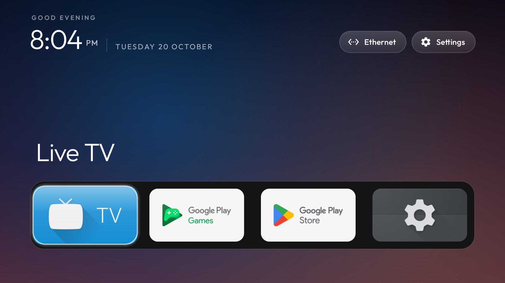

# Sky

An optional backdrop that follows the clock: night blues until dawn, a soft blue day, then a warm
horizon that peaks just before eight in the evening. It is off in the built-in configuration, so a
launcher built from this repository behaves exactly like before until a theme turns it on.

```json
{ "sky_intensity": 60 }
```



Push that as a theme's `config.json` and restart Home:

```bash
TV_HOST=192.168.1.50 tools/theme.sh themes/your-theme
```

## What it draws

A full-screen gradient in three bands — top, middle, bottom — with a soft warm glow near the horizon
whose horizontal position follows the sun: left at sunrise, right at sunset. `sky_intensity` is its
opacity, 0 to 100; the colours themselves are interpolated between a handful of anchors through the
day, which is what makes it drift instead of switching at fixed hours.

It sits behind everything, over the wallpaper when there is one, and the palette was chosen dark on
purpose: the white clock, the greeting, the hero name and the dock band all keep their contrast at
the default 60.

## Cost

`Sky` is pure maths — no Android types, no clock of its own; the caller passes the minutes since
midnight, which is why the palette is unit-tested on the JVM. `SkyView` renders one 480×270 bitmap
and redraws it once a minute, from the same minute tick that updates the clock. Nothing is animated
and nothing is requested: the backdrop is the only change, and a TV with 1 GB of RAM has nothing to
keep up with.

Turning the key off restores the plain background (or the theme's `wallpaper`/`background_color`)
on the next Home start.
